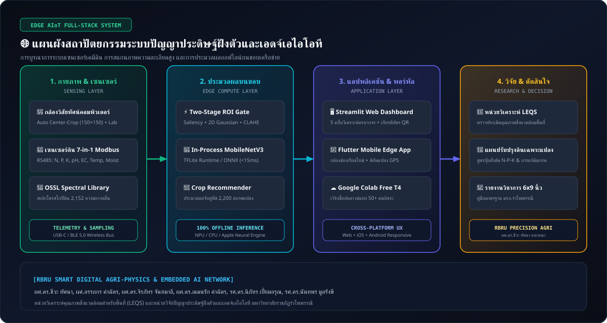
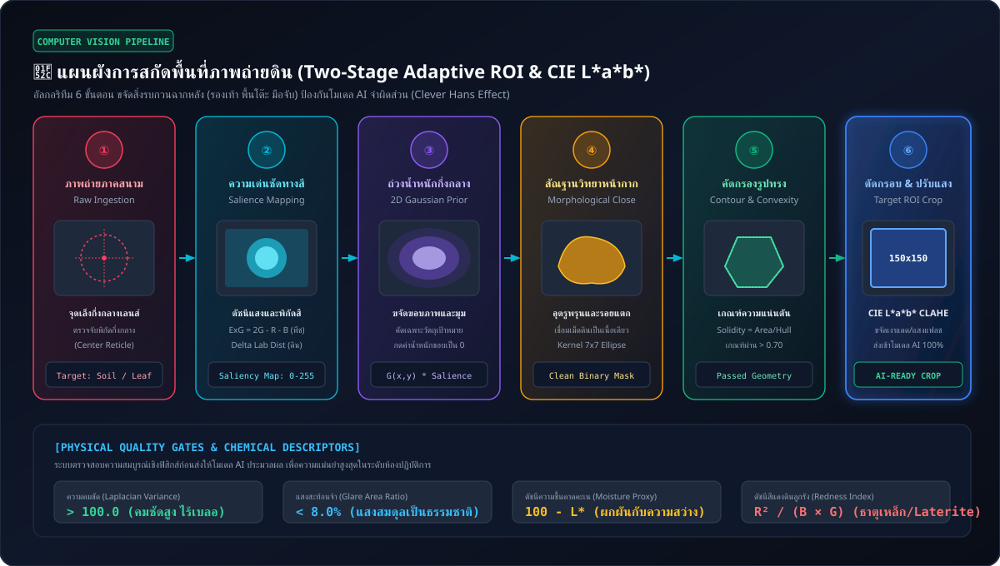
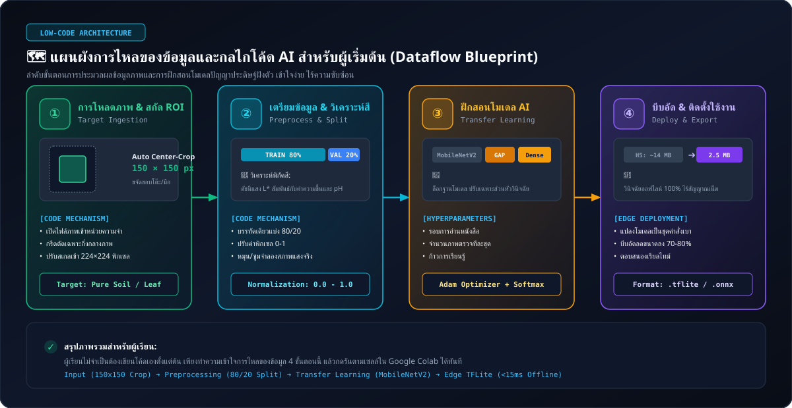
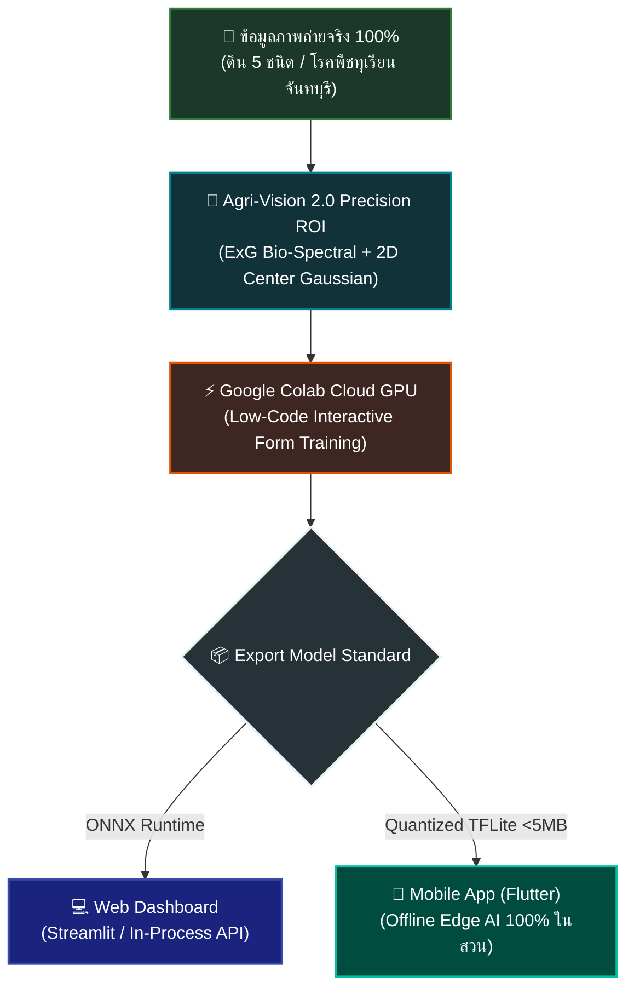
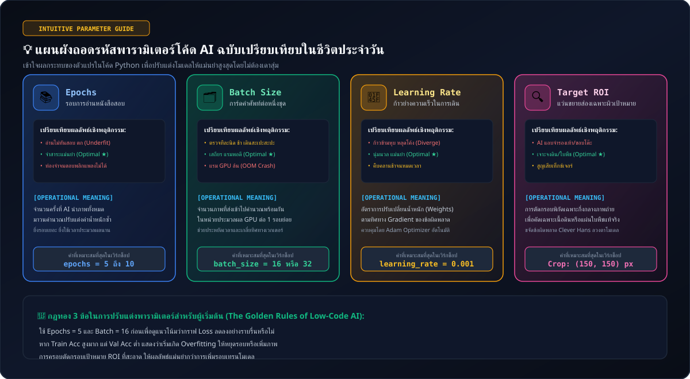
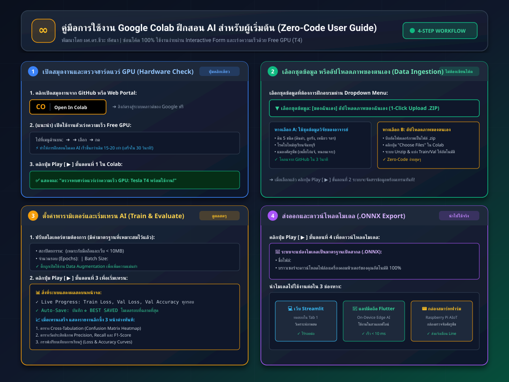
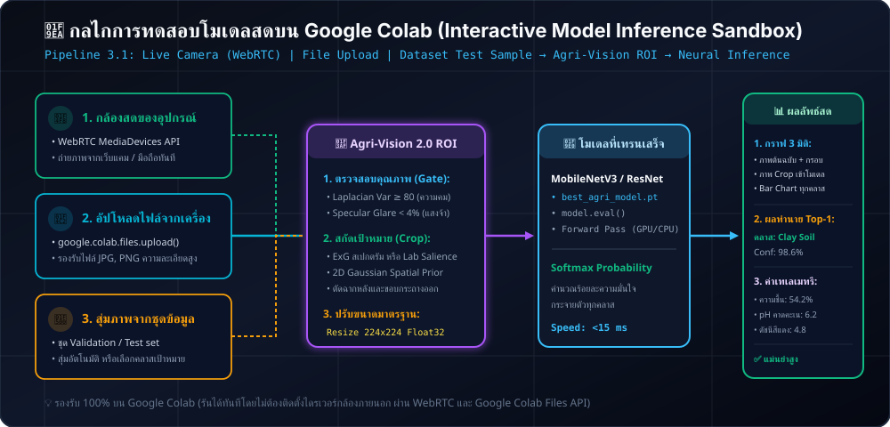

# 🌱 Embedded AI & Edge AIoT for Agriculture and Environment
## ปัญญาประดิษฐ์ฝังตัวและเอดจ์เอไอโอทีเพื่อการเกษตรและสิ่งแวดล้อม
### จากวิศวกรรมข้อมูลภาพระดับพิกเซลและเซนเซอร์เคมีดิน สู่การพัฒนาอุปกรณ์วินิจฉัยอัจฉริยะภาคสนาม
**คณะผู้วิจัยและวิทยากร:** ผศ.ดร.ชีวะ ทัศนา (หัวหน้าโครงการ), ผศ.อรรถกร คำฉัตร, ผศ.ดร.จิรภัทร จันทมาลี, ผศ.ดร.ณมนรัก คำฉัตร, รศ.ดร.นิภัทร เปี่ยมอรุณ, รศ.ดร.นันทพร มูลรังษี  
**หน่วยงานสนับสนุน:** หน่วยวิเคราะห์คุณภาพสิ่งแวดล้อมสำหรับพื้นที่ (LEQS) และหน่วยวิจัยปัญญาประดิษฐ์ฝังตัวและเอดจ์เอไอโอทีเพื่อเกษตรดิจิทัลและสิ่งแวดล้อม | มหาวิทยาลัยราชภัฏรำไพพรรณี

> 📖 **คู่มือวิชาการ 66 หน้า (XeLaTeX 6×9 นิ้ว):** [`docs/Digital_Agri_xAI_Handbook_6x9.pdf`](docs/Digital_Agri_xAI_Handbook_6x9.pdf)  
> 🖼️ **คลังภาพทุกขั้นตอน (Step-by-Step Gallery):** [`docs/STEP_BY_STEP_GALLERY.md`](docs/STEP_BY_STEP_GALLERY.md)  
> 📱 **แอปพลิเคชันมือถือ Flutter (Edge Inference):** [`digital_agri_xai_mobile/`](digital_agri_xai_mobile/)

ระบบปัญญาประดิษฐ์ฝังตัวและโครงข่ายไอโอทีบนขอบเครือข่ายเพื่อการเกษตรและสิ่งแวดล้อม (Embedded AI & Edge AIoT Diagnostic Platform) รองรับการประมวลผลบนอุปกรณ์ขอบและสมาร์ทโฟนแบบออฟไลน์ 100% ไร้สัญญาณอินเทอร์เน็ต (In-Process Edge AI, Quantized TFLite, ONNX Runtime) ผสานการวิเคราะห์ภาพถ่ายความแม่นยำสูง (Agri-Vision 2.0 Precision ROI), สเปกโทรสโกปี และระบบแนะนำพืชจากเซนเซอร์เคมีดินภาคสนาม



---

## 📦 โครงสร้างคลังชุดข้อมูลงานวิจัย (Research Dataset Architecture)

ชุดข้อมูลทั้งหมดถูกจัดระเบียบตามมาตรฐานวิชาการ แบ่งออกเป็น **2 เสาหลัก (Main Pillars)** รวมกว่า 2,583+ ไฟล์:

### 1. 🧪 ระบบอัจฉริยะด้านดิน (Soil Analysis) — แบ่งเป็น 4 กลุ่มย่อย
* **1.1 การจำแนกชนิดเนื้อดิน (Soil Type Classification):** 156 ภาพจริง แบ่ง 5 คลาส (`black_soil`, `laterite_soil`, `cinder_soil`, `peat_soil`, `yellow_soil`) พร้อมโฟลเดอร์ `train/` และ `val/`
* **1.2 ธาตุอาหารและการปรับปรุงดินเฉพาะประเทศไทย (Thai Soil & Fertilizer Amendment):** ไฟล์ `thai_soil_crop_recommendation.csv` รวบรวมข้อมูล N-P-K, pH, ความชื้น, แนะนำพืชปลูกเศรษฐกิจไทย และแนวทางการปรับปรุงดิน (การหว่านโดโลไมต์, มูลค้างคาว ฯลฯ)
* **1.3 ธาตุอาหารเคมีและพืชแนะนำสากล (Global Soil Chemistry & Crop Recommender):** ไฟล์ `Crop_recommendation.csv` รวม 2,200 แถว / 22 พืช เชื่อมโยงกับ Nearest Centroid Recommender ในหน้าเว็บ Tab 2
* **1.4 สเปกโตรสโกปีดินขั้นสูง (Advanced Soil Spectroscopy - OSSL & NeoSpectra):** ไฟล์สเปกตรัม Mid-IR (`sample_mir_data.csv`), VisNIR (`sample_visnir_data.csv`), NeoSpectra, และโมเดลพยากรณ์คุณสมบัติดิน OSSL

### 2. 🍃 ระบบอัจฉริยะด้านพืช (Plant) — แบ่งเป็น 3 หมวดหมู่หลัก
* **2.1 โรคพืช (Plant Diseases) — แบ่งเป็น 5 กลุ่มย่อย (1,347 ภาพ):**
  1. *ทุเรียนจันทบุรี (Durian):* 380 ภาพ (แอนแทรคโนส, รากเน่าโคนเน่า, จุดสนิมสาหร่าย, โฟมอปซิส, ปกติ)
  2. *ข้าวโพด (Maize):* 360 ภาพ (ราสนิมข้าวโพด, ใบจุดสีเทา Gray Leaf Spot, ใบไหม้, ปกติ)
  3. *มะเขือเทศ (Tomato):* 360 ภาพ (ใบจุดวงแหวน Early Blight, ใบไหม้ Late Blight, รากำมะหยี่, ปกติ)
  4. *ข้าว (Rice):* 186 ภาพ (ขอบใบแห้ง BLB, ใบจุดสีน้ำตาล Brown Spot, โรคไหม้ Blast, ปกติ)
  5. *มันสำปะหลัง (Cassava):* 61 ภาพ (โรคใบด่างมันสำปะหลัง CMD, ใบไหม้, ขีดสีน้ำตาล, ปกติ)
* **2.2 แมลงศัตรูพืช (Plant Insect Pests) — แบ่งเป็น 3 กลุ่ม (761 ภาพ):**
  1. *ทุเรียน (Durian):* 220 ภาพ (เพลี้ยไก่แจ้ Allocaridara, หนอนเจาะต้น, ไรแดง, ใบสมบูรณ์)
  2. *พืชทั่วไป (General Crops):* 300 ภาพ (หนอนกระทู้ Armyworm, เพลี้ยอ่อน, หนอนใยผัก, แมลงหวี่ขาว, ปกติ)
  3. *ข้าว (Rice):* 241 ภาพ (เพลี้ยกระโดดสีน้ำตาล BPH, หนอนกอข้าว, หนอนห่อใบข้าว, ปกติ)
* **2.3 การขาดธาตุอาหารหลัก (Plant Nutrient Deficiencies) — แบ่งเป็น 4 กลุ่ม (305 ภาพ):**
  1. *พืชทั่วไป (General Crops):* 124 ภาพ (ขาดไนโตรเจน N, ขาดฟอสฟอรัส P, ขาดโพแทสเซียม K, ปกติ)
  2. *ทุเรียน (Durian):* 60 ภาพ (ขาด N, ขาด K, ขาดแมกนีเซียม Mg, ใบสมบูรณ์)
  3. *ข้าวโพด (Maize):* 60 ภาพ (ขาด N ใบเหลืองตัว V, ขาด P ขอบใบไหม้ม่วง, ขาด K ขอบใบแห้ง, ปกติ)
  4. *ข้าว (Rice):* 61 ภาพ (ขาด N, ขาด P, ขาด K, ใบสมบูรณ์)

---

## 🚀 สรุปฟังก์ชันการทำงานหลัก (System Architecture)

### แท็บ 1: 📸 วิเคราะห์ภาพถ่ายดินและใบพืช (Visual Diagnostic AI)
1. **Quick Demo Presets:** ปุ่มเลือกภาพตัวอย่างด่วน (ใบพืชสมบูรณ์, ขาด N, ขาด P, ขาด K, ดินดำ, ดินลูกรัง, ดินเหนียว, ดินร่วนปนทราย) โหลดภาพและบริบทพื้นที่ทันทีโดยไม่ต้องค้นหาไฟล์
2. **Hybrid AI Engine Selector:**
   - ☁️ **Cloud API:** Google Gemini 2.5 Flash / 1.5 Flash (ฉลาดรอบด้าน ภาษาไทยสละสลวย)
   - 💻 **Local Runtime:** Ollama API (`localhost:11434`) ออฟไลน์ 100% บน Apple Silicon (แนะนำโมเดล `llava`)
   - 🎯 **Custom Edge AI:**
     - **In-Process Offline Engine (แนะนำ):** รันตรงในตัวแอป 100% ออฟไลน์ ไม่ต้องเปิดเซิร์ฟเวอร์ภายนอก ไร้ปัญหา Connection Refused
     - **External REST API:** เชื่อมต่อพอร์ต 8000 (มี Auto-fallback สลับมา In-Process ทันทีหากเซิร์ฟเวอร์ปิดอยู่)
3. **🎯 Agri-Vision 2.0 Precision ROI Extraction:**
   - 🌿 **Bio-Spectral Index (ExG):** สกัดสัญญาณคลอโรฟิลล์ใบพืชด้วยดัชนี $ExG = 2G - R - B$ ร่วมกับ HSV Chlorophyll Filter ตัดสัญญาณรบกวนของฉากหลังออกอย่างถาวร
   - 🎯 **2D Center Gaussian Spatial Prior:** ถ่วงน้ำหนักความน่าจะเป็นเชิงพื้นที่ $W_\text{prior} = \exp(-\frac{\Delta x^2}{2\sigma_x^2} - \frac{\Delta y^2}{2\sigma_y^2})$ มุ่งเน้นวัตถุตรงกลางภาพ ตัดขอบมุมและสิ่งรบกวนขอบเฟรม
   - 🛡️ **Automated Quality Gates:** ตรวจวัดความคมชัด (Laplacian Variance $\ge 80$), ป้องกันแสงแดดสะท้อนตรง (Specular Glare $< 4\%$) และชดเชยเงามืดด้วย CIE $L^*a^*b^*$ CLAHE
   
   

4. **🌈 สตูดิโอสุ่มวิเคราะห์หลายจุด & เปรียบเทียบปริภูมิสี (Multi-Point & Color Space Studio):**
   - 🎛️ **Dropdown เลือกลักษณะการสุ่มตัวอย่าง (Sampling Strategy):**
     - ⭐ *Composite 5-Point (W/Star Sampling):* มาตรฐานการสุ่มดิน 5 จุดรวม (จุดกึ่งกลางแปลง + 4 มุมตัวแทน) ตามหลักปฐพีวิทยา
     - 🎯 *Single Center (1 จุดกึ่งกลาง):* สำหรับทดสอบวัตถุเดี่ยวตรงกลาง
     - 🗺️ *3x3 Spatial Grid (ตารางเมทริกซ์ 9 โซน A1-C3):* สร้างแผนที่ความแปรปรวนเชิงพื้นที่แบบ Micro-topography
     - 📍 *Custom Coordinates (สุ่มพิกัดเอง):* เลื่อนสไลเดอร์ X-Y เพื่อกำหนดจุดวิเคราะห์ได้อิสระ
   - 🌈 **Dropdown เลือกและเปรียบเทียบปริภูมิสี (Color Space & Radiometric Calibration):**
     - 🖼️ *All 6 Channels Side-by-Side:* แสดงเปรียบเทียบพร้อมกัน 6 แชนแนล (RGB, HSV, CIE $L^*a^*b^*$, ExG, CLAHE Equalization, Clean Binary Mask)
     - 🎚️ หรือเลือกดูเจาะลึกเฉพาะแชนแนลที่สนใจ
   - 📊 **ดัชนีความสม่ำเสมอของแปลง (Spatial Homogeneity Index):** คำนวณ $H_{\text{spatial}} = 100 - \text{CV}_{\%}$ และออกข้อวินิจฉัยเชิงพื้นที่แบบเรียลไทม์ (ดินสม่ำเสมอเหมาะกับการหว่านปุ๋ยสูตรเดียวทั้งแปลง หรือ ดินแปรปรวนสูงควรใช้การให้ปุ๋ยแบบเฉพาะเจาะจง VRA)
   - 📋 **ตารางเปรียบเทียบข้อมูลรายจุด (Point-by-Point Data Comparison Table):** แสดงค่า $L^*, a^*, b^*$, ดัชนีความชื้นคาดคะเน (\%), ดัชนีสีแดงดินลูกรัง, ความคมชัด Laplacian, ค่า pH คาดคะเน และกลุ่มดินที่คาดคะเน
5. **Structured Diagnostic Output:** แสดงผลสถานะปัญหา, อาการที่พบ, คำแนะนำเชิงปฏิบัติ, และค่าความมั่นใจ (Confidence Score)
6. **Export Diagnostic Report:** ปุ่มดาวน์โหลดรายงานผลเป็น **JSON** และ **Markdown Summary Card**

### แท็บ 2: 🧪 วิเคราะห์ธาตุอาหารเคมีและแนะนำพืช (Soil Sensor & Crop AI)
1. **Field Sensor Inputs:** รับค่า ไนโตรเจน (N), ฟอสฟอรัส (P), โพแทสเซียม (K), ค่าความเป็นกรด-ด่าง (pH), อุณหภูมิ, ความชื้น, ปริมาณน้ำฝน
2. **Sensor Presets:** ทางลัดจำลองค่าจากแปลงจริง เช่น นาข้าวชลประทาน, สวนไม้ผล/ทุเรียนจันทบุรี, ไร่ข้าวโพด, แปลงถั่วบำรุงดิน, สวนกาแฟ
3. **Crop Recommender Engine:** คำนวณความเหมาะสมของพืช 22 ชนิด (2,200 แปลงตัวอย่าง) แสดงผล 3 อันดับแรก พร้อมค่าความเหมาะสม (%) และค่า N-P-K-pH ที่เหมาะสมตามหลักวิชาการ
4. **Fertilizer Action Plan:** แนะนำการจัดการปุ๋ยสั่งตัดและปรับปรุงโครงสร้างดินอย่างแม่นยำ

### แท็บ 3: 🎓 สตูดิโอฝึกสอน AI ด้วยตัวเอง (No-Code AI Trainer Studio)
1. **No-Code 4-Step Pipeline:** ผู้เข้าอบรมที่ไม่มีพื้นฐานโปรแกรมสามารถเลือกชุดข้อมูล (ดิน 5 ชนิด, อาการขาด N-P-K, โรคทุเรียนจันทบุรี)
2. **Interactive Hyperparameters:** เลื่อนสไลเดอร์ปรับจำนวนรอบ Epochs (3-20), Batch Size และเปิดระบบ Data Augmentation
3. **Live Training Visualization:** กราฟเส้นความแม่นยำ (Validation Accuracy) และค่า Loss แบบ Real-time
4. **Instant Export & In-App Testing:** ดาวน์โหลดโมเดล `.onnx` และมีปุ่มคลิกเดียวส่งโมเดลใหม่ไปทดสอบในแท็บที่ 1 ทันที

---

## 🎓 สมุดงานสำหรับจัดอบรม (Workshop Notebook)
ผู้เข้าอบรมสามารถเปิดไฟล์สมุดงาน [Smart_Agri_AI_LowCode_Workshop.ipynb](Smart_Agri_AI_LowCode_Workshop.ipynb) บน Google Colab ได้โดยตรง:

[](https://colab.research.google.com/github/Tsanaphy2023/smart-agri-xai-workshop/blob/main/Smart_Agri_AI_LowCode_Workshop.ipynb)

### 🗺️ แผนผังภาพรวมการทำงานของโค้ดและระบบสำหรับผู้เริ่มต้น (Low-Code Visual Blueprint)





#### 💡 แผนผังถอดรหัสพารามิเตอร์โค้ด AI ฉบับภาษาชาวบ้าน:



| พารามิเตอร์ในโค้ด | คำอุปมาอุปไมยในชีวิตประจำวัน | หน้าที่และความหมายเชิงปฏิบัติการ | ค่าที่แนะนำสำหรับ Workshop |
| :--- | :--- | :--- | :--- |
| `enable_target_roi_crop` | **การเอาแว่นขยายส่องเฉพาะจุด** | สกัดเอาเฉพาะพิกัดดินตรงกลางเลนส์ 150×150 px ขจัดขอบโต๊ะ รองเท้า หรือนิ้วมือ | `True` (เปิดใช้งานเสมอ) |
| `epochs` | **จำนวนรอบอ่านหนังสือสอบ** | จำนวนครั้งที่ AI ได้กวาดสายตาดูภาพตัวอย่างทั้งหมดซ้ำๆ เพื่อจดจำลักษณะสำคัญ | `5 – 10` รอบ |
| `batch_size` | **จำนวนการ์ดคำศัพท์ที่ทบทวนต่อครั้ง** | จำนวนรูปภาพที่ส่งเข้าไปคำนวณพร้อมกันใน GPU เพื่อประหยัดเวลาและแรม | `16 หรือ 32` ภาพ |
| `learning_rate` | **ก้าวย่างความเร็วในการเดิน** | ก้าวสั้นเกินไปเดินช้า (เรียนรู้ช้า) ก้าวยาวเกินไปสะดุดหกล้ม (โมเดลหลุดโค้ง) | `0.001` |
| `sigma_center_scale` | **วงรัศมีโฟกัสกึ่งกลาง** | ขนาดวงรีความสนใจตรงกลางภาพ ป้องกันการตัดขอบวัตถุ | `0.35` (หากชิดขอบให้ปรับเป็น `0.45`) |
| `min_solidity` | **ความแน่นตันของรูปทรง** | อัตราส่วนเนื้อที่ของวัตถุชีวภาพ ป้องกันการตีกรอบแตกแขนง | `0.70` (เกณฑ์มาตรฐานเนื้อดินและใบพืช) |

---

### 📖 แผนภาพคู่มือการใช้งาน Colab สำหรับผู้เข้าอบรม (4-Step Visual Guide)


### 📌 4 ขั้นตอนการใช้งานที่ง่ายที่สุด (Zero-Code Friendly)
1. **⚡ ขั้นที่ 1: ตรวจสอบและเปิดใช้งาน Free GPU (T4)**
   - ไปที่เมนูบนสุดของ Colab: **Runtime (รันไทม์) > Change runtime type (เปลี่ยนประเภทรันไทม์)**
   - เลือกฮาร์ดแวร์เร่งความเร็วเป็น **T4 GPU** แล้วกดบันทึก
   - กดปุ่มรันเซลล์ที่ 1 เพื่อโหลด Library และยืนยันความพร้อมของ GPU
2. **📂 ขั้นที่ 2: เลือกชุดข้อมูลผ่านฟอร์ม Interactive**
   - **กรณีใช้ชุดข้อมูลมาตรฐาน:** เลือกจากเมนูดรอปดาวน์ภาษาไทย (Soil Analysis, โรคพืช, แมลงศัตรูพืช, ขาดธาตุอาหาร N-P-K)
   - **กรณีใช้ชุดข้อมูลของตัวเอง:** ติ๊กเลือก `use_custom_zip_upload` แล้วคลิกอัปโหลดไฟล์ `.zip` (ระบบจะแตกไฟล์และแบ่ง Train 80% / Val 20% อัตโนมัติ)
3. **🚀 ขั้นที่ 3: ฝึกสอนโมเดลและดูรายงานผลลัพธ์ (Live & Post-Training Diagnostics)**
   - ปรับรอบ Epochs (เช่น 5-10 รอบ) แล้วกดรันเพื่อเริ่มเทรน
   - ระบบจะแสดงตารางความคืบหน้าแบบ Real-time พร้อมแถบสีเขียว
   - เมื่อเทรนเสร็จ จะแสดง **Confusion Matrix**, **Precision / Recall / F1-Score** และ **Model Specs Card**
4. **🧪 ขั้นที่ 3.1: ทดสอบโมเดลสดทันทีบน Colab (Interactive Model Inference Sandbox)**
   - **📸 ถ่ายภาพสดผ่านกล้องอุปกรณ์:** สตรีมกล้องเว็บแคมหรือสมาร์ทโฟนผ่าน WebRTC ถ่ายภาพหน้าดินหรือใบพืชสดๆ จากแปลง
   - **📂 อัปโหลดไฟล์ภาพจากเครื่อง:** ลากวางไฟล์ภาพถ่ายจริงขึ้นทดสอบผ่าน `google.colab.files.upload()`
   - **🔀 สุ่มภาพทดสอบจากชุดข้อมูล:** ทดสอบความแม่นยำกับภาพใน Validation Set ที่โมเดลไม่เคยเห็น
   - **📊 แสดงผลสด 3 มิติ:** ภาพต้นฉบับพร้อมกรอบ ROI อัตโนมัติ, ภาพครอป 224x224, กราฟแท่งความน่าจะเป็นทุกคลาส (Top-K Bar Chart), ดัชนีความชื้นคาดคะเน ($100 - L^*$) และดัชนีสีแดงดินลูกรัง
   
   

5. **📥 ขั้นที่ 4: ส่งออกและดาวน์โหลดโมเดล `.onnx` อัตโนมัติ**
   - ระบบแปลงโมเดลเป็นฟอร์แมตมาตรฐาน ONNX สำหรับอุปกรณ์ Edge
   - เบราว์เซอร์จะดาวน์โหลดไฟล์ `smart_agri_model.onnx` ลงเครื่องผู้เรียนทันที นำไปทดสอบใน Streamlit Web App หรือแอปพลิเคชันได้เลย


---

## 🛠️ วิธีการรันใช้งาน

### 1. รันเว็บแอปพลิเคชัน (Streamlit Web App)
```bash
cd "/Users/chewathassana/Desktop/6_My_Business/6.2_Products_Services/smart-soil-ai"
./run.sh
```
หรือรันผ่าน Virtual Environment โดยตรง:
```bash
source .venv/bin/activate
streamlit run app.py
```
เปิดใช้งานที่: `http://localhost:8501` (หรือ `8502`)

### 2. (ทางเลือก) รัน REST API Microservice สำหรับอุปกรณ์ Edge / Flutter
หากต้องการเปิด REST Endpoint บนพอร์ต 8000 ให้กับแอปมือถือหรืออุปกรณ์ภายนอก:
```bash
source .venv/bin/activate
python server.py
```
- Endpoint ตรวจสอบสถานะ: `GET http://localhost:8000/health`
- Endpoint วิเคราะห์ภาพ: `POST http://localhost:8000/predict`
- Endpoint แนะนำพืช: `POST http://localhost:8000/recommend_crops`

---

## 💡 แนวทางการแก้ปัญหาข้อผิดพลาดที่พบบ่อย (Troubleshooting)

| ข้อผิดพลาดที่พบ | สาเหตุ | วิธีการแก้ไข |
| :--- | :--- | :--- |
| **`Errno 61 Connection refused` (พอร์ต 8000)** | เลือกโหมด Custom Model แต่ไม่ได้เปิดเซิร์ฟเวอร์ภายนอกไว้ | ในแอปใหม่นี้ ระบบมี **In-Process Engine** ในตัวเป็นค่าเริ่มต้น ซึ่งรันได้ทันทีโดยไม่ต้องเปิดเซิร์ฟเวอร์ หรือหากเลือก REST API ระบบจะ Auto-fallback ให้ทันที |
| **`unknown model architecture: 'mllama'` (Ollama HTTP 500)** | เลือกโมเดล `llama3.2-vision` แต่ Ollama ในเครื่องยังเป็นเวอร์ชันเก่า | 1. สลับไปใช้โมเดล **`llava`** ในแถบด้านซ้าย (รองรับ 100% ทุกเวอร์ชัน)<br>2. หรืออัปเดต Ollama ด้วยคำสั่ง `brew upgrade ollama` ใน Terminal |
