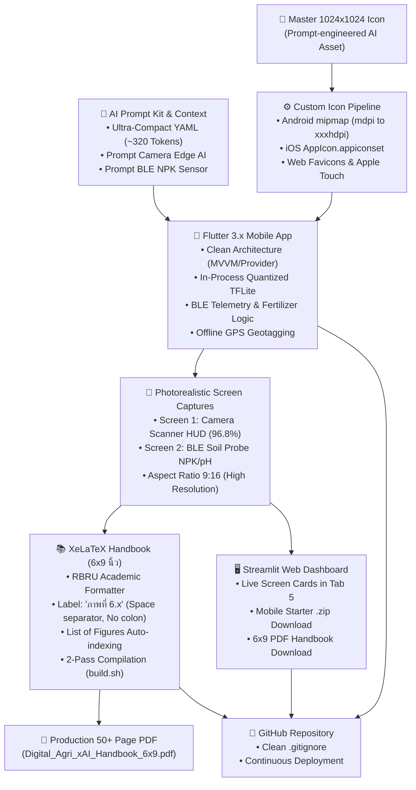

# 📱 Digital Agri xAI: Mobile App, Screen Capture & LaTeX Handbook Architect

**digital-agri-mobile-latex-architect** คือกรอบการทำงานและระบบอัตโนมัติครบวงจร (End-to-End Pipeline) สำหรับนักวิจัย วิศวกร และผู้เข้าอบรม ในการแปลง **Context Prompt & AI Prompt Kit** ให้กลายเป็น **แอปพลิเคชันสมาร์ทโฟน (Flutter Mobile App)** ที่ใช้งานได้จริง พร้อมทั้งสร้าง **ภาพแคปหน้าจอ UI เสมือนจริง (Photorealistic Screen Captures)** นำไปบรรจุลงใน **คู่มือและตำราวิชาการ XeLaTeX ขนาด 6 × 9 นิ้ว** ตามมาตรฐานของมหาวิทยาลัยราชภัฏรำไพพรรณี (RBRU Standards) และเชื่อมต่อกับ **Web Dashboard (Streamlit/FastAPI)** สู่การส่งมอบงานบน GitHub อย่างเป็นระบบ

---

## 🏛️ สถาปัตยกรรมระบบโดยรวม (End-to-End Workflow)



---

## 📋 1. การแปลง Context Prompt สู่โครงสร้าง Flutter Mobile App

### 1.1 สเปกของ Ultra-Compact System Context (~320 Tokens)
ในการสั่งสร้างโมบายล์แอปพลิเคชันผ่าน Cursor, VS Code Copilot หรือ Google Antigravity ให้แนบส่วนหัวคอนเทกต์แบบประหยัดโทเค็นดังนี้:

```yaml
PROJECT: Digital Agri xAI Platform
AUTHOR: Asst. Prof. Dr. Chewa Thassana (RBRU Digital Agri-Physics)
DOMAINS:
  1_Soil_Types: [Clay, Loam, Sand, Silt]
  2_Plant_Diseases: [Leaf Spot, Rust, Downy Mildew, Anthracnose, Root Rot]
  3_Pests: [Durian Psyllid, Leaf Miner, Planthopper, Aphid]
  4_Nutrient_Deficiency: [N_Deficient, P_Deficient, K_Deficient, Healthy]
MODELS:
  Mobile_Edge: smart_agri_model.tflite (TensorFlow Lite, Quantized Float32, <6MB)
SENSORS: N-P-K (mg/kg), pH (3.5-9.5), Moisture (%), Temp (°C)
MOBILE_STACK:
  Framework: Flutter 3.x, Dart, Strict Null Safety, Zero Overflow
  State: Provider (MVVM Architecture)
  Packages: tflite_flutter, camera, flutter_blue_plus, geolocator, sqflite
  Aesthetics: Dark Obsidian (#090D16), Vibrant Emerald (#10B981), Cyber Cyan (#06B6D4)
```

### 1.2 โครงสร้างโฟลเดอร์ Clean Architecture มาตรฐาน
```text
digital_agri_xai_mobile/
├── lib/
│   ├── core/
│   │   └── theme/
│   │       └── app_theme.dart          # โทนสี Dark Obsidian, Accent Emerald & Cyan
│   ├── models/
│   │   ├── diagnostic_result.dart      # ข้อมูลผลการวินิจฉัยโรคและธาตุอาหาร
│   │   └── soil_sensor_data.dart       # ข้อมูลเคมีดิน NPK, pH และคำนวณปุ๋ยสั่งตัด
│   ├── providers/
│   │   ├── scanner_provider.dart       # ควบคุมกล้องและการทำนาย Edge AI ออฟไลน์
│   │   └── sensor_provider.dart        # เชื่อมต่อ BLE และอ่านค่าจากหัวโพรบดิน
│   ├── ui/
│   │   └── screens/
│   │       ├── camera_scanner_screen.dart # หน้าจอส่องกล้องมีกรอบเล็งเป้าหมาย
│   │       ├── soil_sensor_screen.dart    # หน้าจอเกจวัดโทรมาตรดิน NPK & pH
│   │       └── field_history_screen.dart  # หน้าจอบันทึกประวัติแปลงพร้อม GPS
│   └── main.dart                       # MultiProvider, AppTheme, BottomNavBar
├── assets/
│   ├── icons/                          # ไอคอนแอปทุกขนาด
│   └── models/                         # smart_agri_model.tflite
└── pubspec.yaml
```

---

## 🎨 2. ระบบสร้าง Custom App Icon Pipeline อัตโนมัติ

ห้ามใช้ไอคอนเริ่มต้นของ Flutter โดยเด็ดขาด ให้ใช้สคริปต์ Python ในการสร้างไอคอนครบทุกแพลตฟอร์มจากภาพ Master Image (1024×1024 px):

### 2.1 สคริปต์แปลงไอคอน (`generate_icons.py`)
```python
import os
from PIL import Image

def generate_app_icons(master_icon_path, app_root):
    img = Image.open(master_icon_path).convert("RGBA")
    
    # Android Launcher Mipmaps
    android_res = os.path.join(app_root, "android", "app", "src", "main", "res")
    android_sizes = {
        "mipmap-mdpi": 48,
        "mipmap-hdpi": 72,
        "mipmap-xhdpi": 96,
        "mipmap-xxhdpi": 144,
        "mipmap-xxxhdpi": 192,
    }
    for folder, size in android_sizes.items():
        out_dir = os.path.join(android_res, folder)
        os.makedirs(out_dir, exist_ok=True)
        img.resize((size, size), Image.Resampling.LANCZOS).save(os.path.join(out_dir, "ic_launcher.png"))
        img.resize((size, size), Image.Resampling.LANCZOS).save(os.path.join(out_dir, "ic_launcher_round.png"))
        
    # iOS Assets.xcassets
    ios_dir = os.path.join(app_root, "ios", "Runner", "Assets.xcassets", "AppIcon.appiconset")
    os.makedirs(ios_dir, exist_ok=True)
    img.resize((1024, 1024), Image.Resampling.LANCZOS).save(os.path.join(ios_dir, "Icon-App-1024x1024@1x.png"))
    print("✅ App Icons Generated Successfully for Android and iOS!")
```

---

## 📸 3. ระบบสร้างภาพแคปหน้าจอ (Photorealistic Screen Captures)

เพื่อนำภาพหน้าจอไปใส่ในตำราวิชาการ ต้องสร้างภาพในสัดส่วน **9:16** ความละเอียดสูง คมชัดทุกตัวอักษร ไม่ผิดเพี้ยน:

### 3.1 Prompt สำหรับสร้างภาพหน้าจอ AI Camera Scanner
> **Prompt:** "UI design of a modern futuristic mobile smartphone app screen for 'Digital Agri xAI: Edge Camera Scanner'. A hand holds a sleek smartphone in a durian plantation. Screen displays live camera targeting a durian leaf with a vibrant neon emerald (#10B981) targeting reticle and cyber scanning grid. Top status bar shows 'ON-DEVICE AI: ACTIVE (18ms)'. Floating glassmorphic card shows 'DIAGNOSIS: 96.8% Confidence, โรคแอนแทรคโนสใบไหม้ (Colletotrichum), ACTION PLAN: ตัดแต่งใบที่เป็นโรค และฉีดพ่นสารทองแดง'. Large circular emerald SCAN button. Ultra-sharp, photorealistic mockup, zero distortion."

### 3.2 Prompt สำหรับสร้างภาพหน้าจอ BLE Soil Telemetry HUD
> **Prompt:** "UI design of a modern futuristic mobile smartphone app screen for 'Digital Agri xAI: Soil Telemetry & Sensor HUD'. Dark obsidian background (#090D16) with neon emerald (#10B981) and cyan (#06B6D4) accents. Top header displays 'BLE Soil Probe: CONNECTED' with green pulsing dot and battery indicator. Center features high-tech telemetry circular radial gauges and sleek glassmorphic data cards showing real-time soil metrics: Nitrogen (N: 48 mg/kg), Phosphorus (P: 18 mg/kg), Potassium (K: 120 mg/kg), Soil pH (pH: 5.8), Soil Moisture (72%), and Temperature (28.4°C). Bottom section features an AI-generated actionable recommendation card: 'คำแนะนำการปรับสภาพดิน: เติมโดโลไมท์ 50 กก./ไร่ และเพิ่มปุ๋ยฟอสเฟต 18-46-0'. Ultra-sharp vector graphics, modern typography, mobile UI mockup."

---

## 📖 4. มาตรฐานการบรรจุภาพลงในคู่มือ XeLaTeX ขนาด 6 × 9 นิ้ว (RBRU Standards)

### 4.1 กฎการจัดวางภาพและคำบรรยาย (Caption Rules)
ตามมาตรฐาน `rbru-academic-formatter` และ `thai-academic-latex-formatting`:
1. **ป้ายชื่อคำบรรยาย:** ต้องใช้คำว่า `ภาพที่` ตามด้วยเลขบทและลำดับภาพ คั่นด้วยการเว้นวรรค 1 เคาะ **ห้ามมีเครื่องหมายทวิภาค (`:`) โดยเด็ดขาด** (เช่น `ภาพที่ 6.1 หน้าจอแอปพลิเคชัน...`)
2. **ตำแหน่งคำบรรยายภาพ:** วางไว้ใต้ภาพ จัดกึ่งกลางหน้ากระดาษ
3. **ความกว้างของภาพหน้าจอ 9:16:** กำหนดขนาดที่ `width=0.50	extwidth` ถึง `width=0.55	extwidth` เพื่อให้ความสูงของภาพไม่เกินพื้นที่ข้อความ (Text Height) ในหน้า 6×9 นิ้ว
4. **ป้องกันเลขหัวข้อซ้ำ:** เมื่อใช้คำสั่ง `cademicsection` ใน `headings.tex` จะมีการแทรก `	hesection` อัตโนมัติ จึงห้ามใส่เลขหัวข้อซ้ำในอาร์กิวเมนต์ เช่น ให้เขียน `cademicsection{การสั่งสร้างสมาร์ทโฟน...}` แทน `cademicsection{6.3 การสั่งสร้าง...}`

### 4.2 ตัวอย่างโค้ด LaTeX สำหรับแทรกภาพในบทที่ 6
```latex
egin{figure}[htbp]
\centering
\includegraphics[width=0.52	extwidth]{figures/mobile_screen_camera_scanner.jpg}
\caption{หน้าจอแอปพลิเคชันสมาร์ทโฟนส่องกล้อง Edge AI วินิจฉัยสุขภาพพืชและโรคใบจุดออฟไลน์แบบเรียลไทม์}
\label{fig:mobile_camera_scanner}
\end{figure}

egin{figure}[htbp]
\centering
\includegraphics[width=0.52	extwidth]{figures/mobile_screen_ble_sensor.jpg}
\caption{หน้าจอแสดงผลข้อมูลโทรมาตรเซนเซอร์ดิน NPK และ pH ผ่านบลูทูธพลังงานต่ำ (BLE) พร้อมคำแนะนำปุ๋ยสั่งตัด}
\label{fig:mobile_ble_sensor}
\end{figure}
```

### 4.3 สคริปต์คอมไพล์ 2 รอบ (`build.sh`)
เพื่อสร้างสารบัญภาพ (List of Figures: `\listoffigures`) และเลขหน้าอ้างอิงให้ถูกต้อง ต้องรัน `xelatex` 2 รอบเสมอ:
```bash
#!/bin/bash
xelatex -interaction=nonstopmode main.tex
xelatex -interaction=nonstopmode main.tex
```

---

## 🖥️ 5. การเชื่อมต่อ Web Dashboard และการส่งมอบงานบน GitHub

### 5.1 การแสดงผลภาพแคปหน้าจอบน Streamlit (`app.py`)
ในแท็บที่ 5 ของระบบ Web Dashboard ให้ใช้การ์ดรูปภาพแบบ 2 คอลัมน์สำหรับจัดแสดงภาพหน้าจอมือถือจริง:
```python
st.markdown("##### 📸 ตัวอย่างหน้าจอจริงของสมาร์ทโฟนแอปพลิเคชัน (Flutter Screen Captures):")
m_col1, m_col2 = st.columns(2)
with m_col1:
    cam_path = "docs/mobile_screen_camera_scanner.jpg"
    if os.path.exists(cam_path):
        st.image(cam_path, caption="📸 ส่องกล้อง Edge AI วินิจฉัยพืชออฟไลน์", use_container_width=True)
with m_col2:
    ble_path = "docs/mobile_screen_ble_sensor.jpg"
    if os.path.exists(ble_path):
        st.image(ble_path, caption="🧪 เซนเซอร์ดิน NPK & BLE Telemetry", use_container_width=True)
```

### 5.2 ปุ่มดาวน์โหลดไฟล์ใน Web Dashboard
* **Mobile Starter .zip:** รวบรวมไฟล์โค้ด Flutter เพื่อให้ผู้เข้าอบรมนำไปพัฒนาต่อ
* **Handbook 6x9 PDF:** ให้ดาวน์โหลดไฟล์ `Digital_Agri_xAI_Handbook_6x9.pdf` โดยตรง

### 5.3 รายการตรวจสอบก่อน Push ขึ้น GitHub (Pre-Flight Checklist)
- [x] ตรวจสอบ `.gitignore` ในโปรเจกต์ Flutter (กรอง `.dart_tool/`, `build/`, `*.lock` ออก)
- [x] ตรวจสอบความถูกต้องของไวยากรณ์ Python ใน `app.py` ด้วย `python3 -m py_compile app.py`
- [x] ตรวจสอบเอกสาร PDF คอมไพล์ผ่าน 50+ หน้า และรูปภาพแสดงผลคมชัด ไร้ Overfull Badness
- [x] ซิงก์ไฟล์ PDF ไปยังโฟลเดอร์ `docs/` เพื่อให้ลิงก์ดาวน์โหลดใช้งานได้สมบูรณ์
- [x] ดำเนินการ `git commit` และ `git push origin main`
