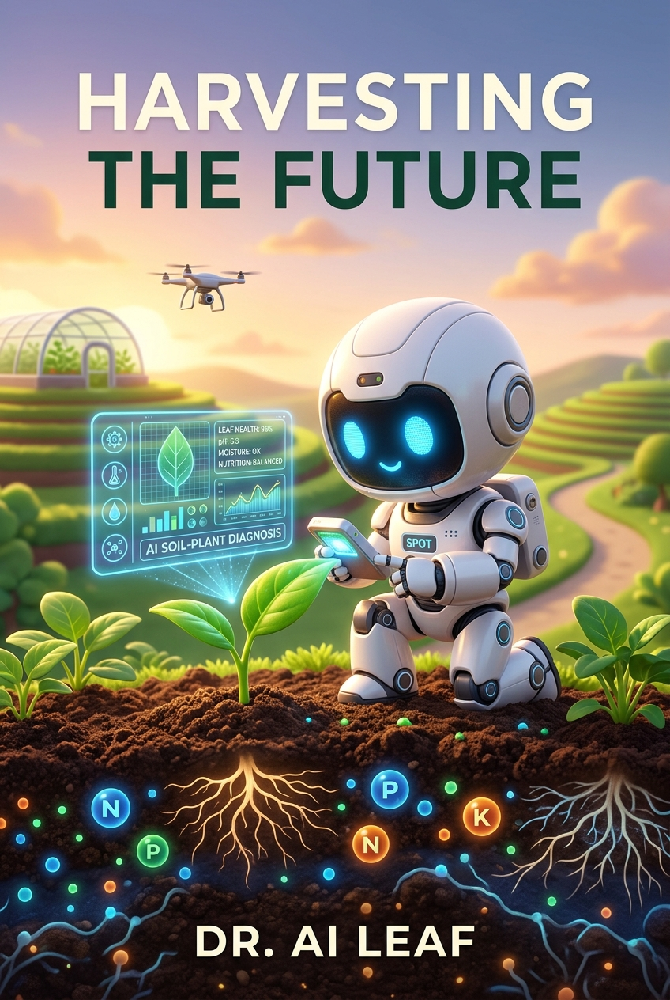
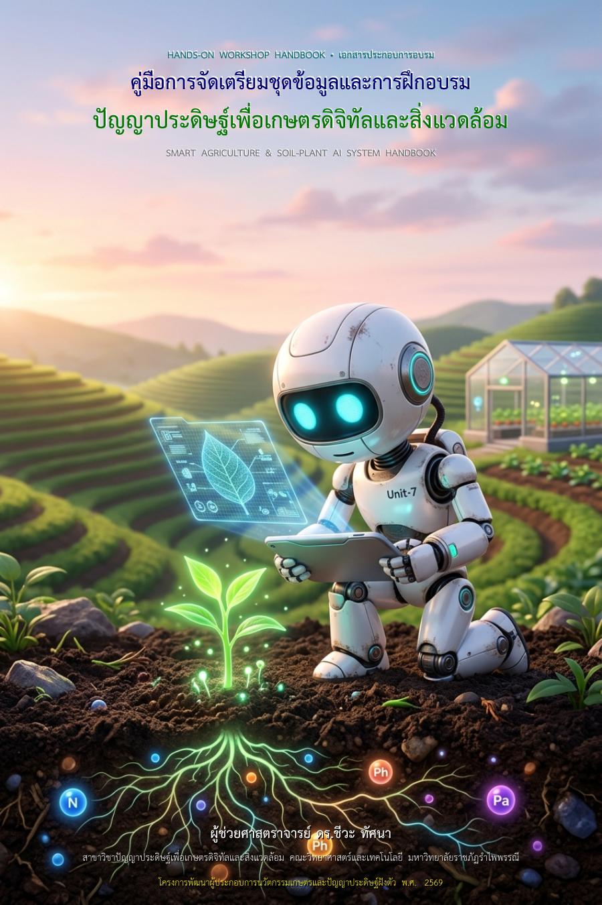
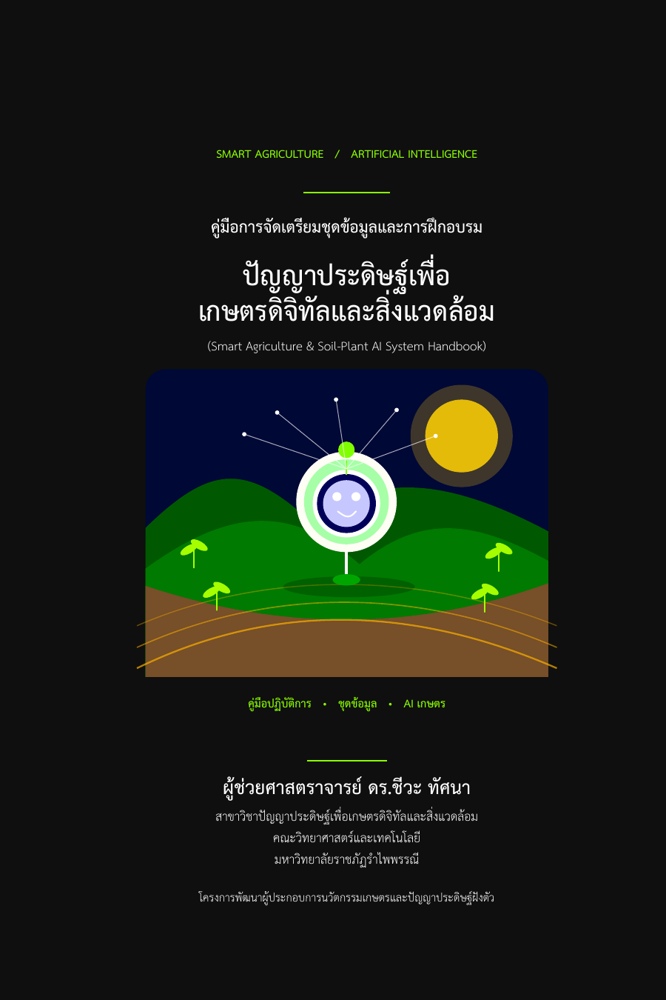
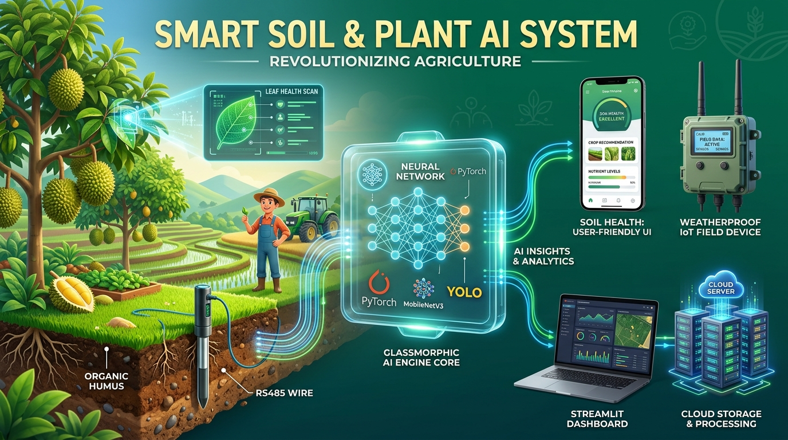
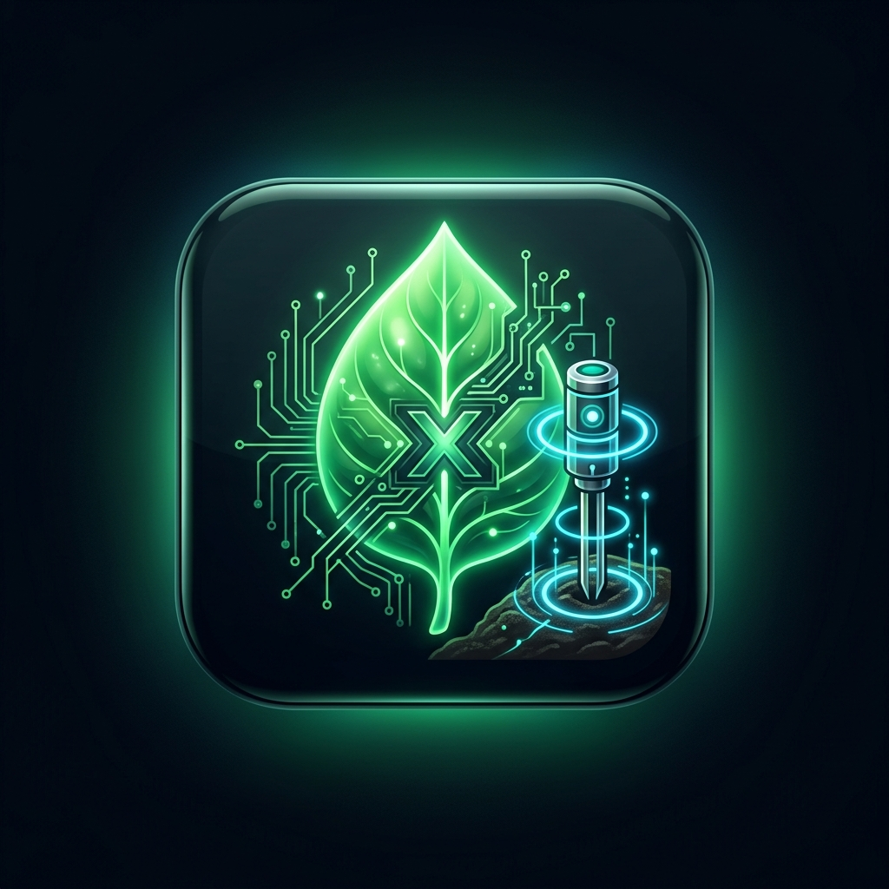
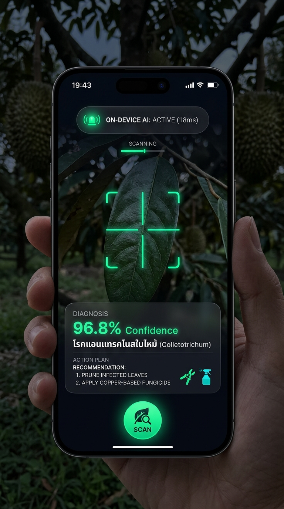
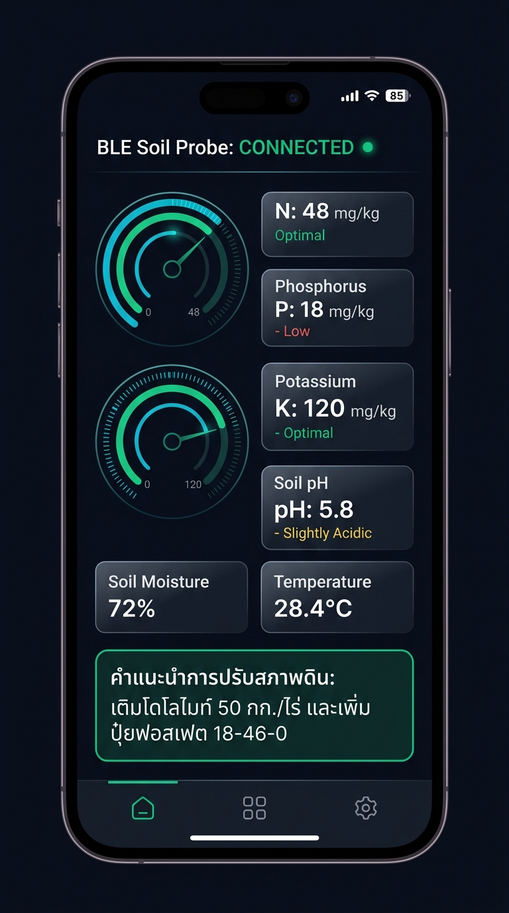
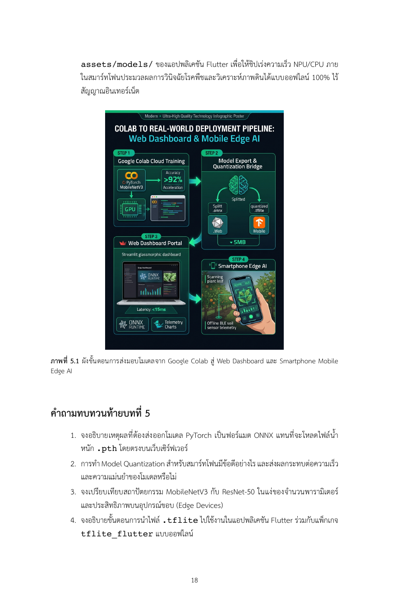
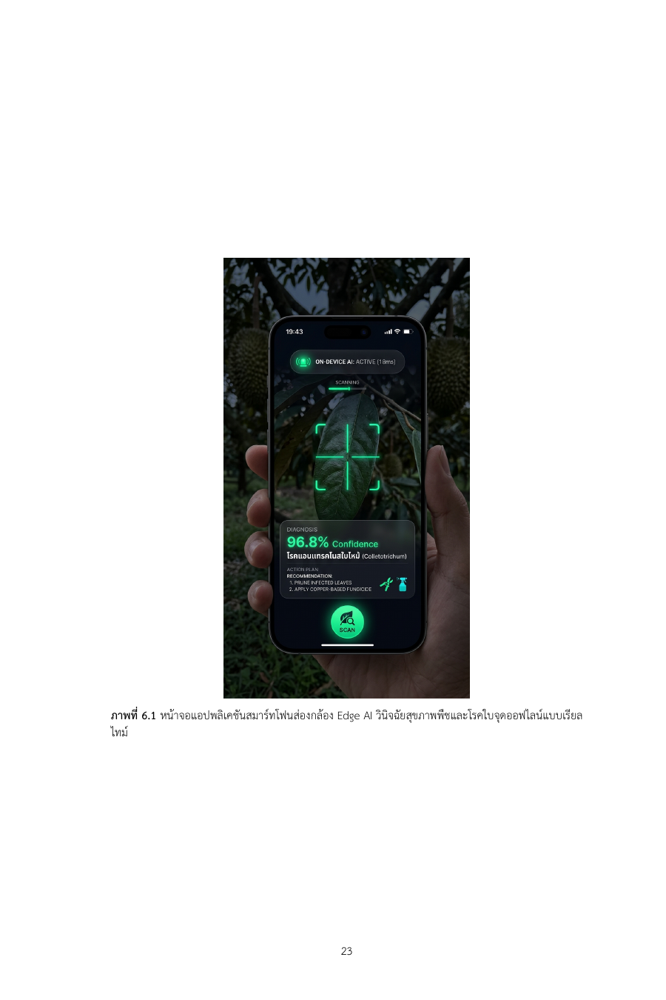
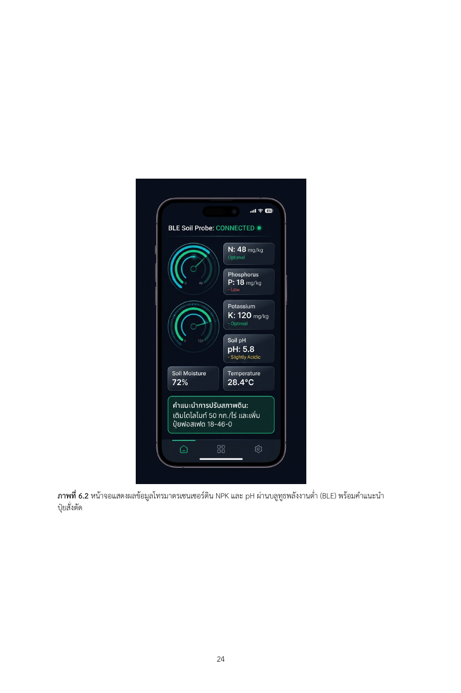

# 🖼️ Digital Agri xAI: คลังรวมภาพทุกขั้นตอน (Step-by-Step Gallery)
> **โครงการ:** Digital Agri xAI Platform & Academic Handbook (มรภ.รำไพพรรณี)  
> **ผู้ประพันธ์และผู้วิจัย:** ผศ.ดร.ชีวะ ทัศนา (Asst. Prof. Dr. Chewa Thassana)  
> **การจัดเก็บ:** บันทึกและควบคุมเวอร์ชันบน GitHub Repository อย่างเป็นระบบ

---

## 📑 สารบัญภาพทุกขั้นตอน (Visual Index)

| ลำดับ | ชื่อไฟล์ภาพ | ขั้นตอนการดำเนินงาน | บทบาทในระบบ / เอกสาร |
| :---: | :--- | :--- | :--- |
| **01** | `01_book_cover_pixar_3d.jpg` | ออกแบบปกตำราวิชาการ 6×9 นิ้ว | ปกนอก 3D Pixar Full-bleed ไร้กล่องทึบบังภาพ |
| **02** | `02_inner_title_art.jpg` | ศิลปกรรมหน้าเปิดตอน | ภาพประกอบส่วนหน้า (Inner Title Art) |
| **03** | `03_book_cover_full_spread_preview.png` | ตรวจสอบหน้าคู่เล่มตำรา | พรีวิวปกนอกคู่ปกหลังมาตรฐาน RBRU |
| **04** | `04_inner_titlepage_preview.png` | หน้าปกในเชิงวิชาการ | ข้อมูลหลักสูตร เลขมาตรฐาน และคณะวิจัย |
| **05** | `05_smart_agri_ai_system_poster.jpg` | ผังรวมระบบและโปสเตอร์หลักสูตร | Infographic ภาพรวมโครงการ Digital Agri xAI |
| **06** | `06_workshop_50p_cloud_diagram.jpg` | แผนผังปฏิบัติการคลาวด์ | โครงสร้าง Google Colab สำหรับ 50 ผู้เข้าอบรม |
| **07** | `07_mobile_app_master_icon_1024.jpg` | ไอคอนโมบายล์แอปเฉพาะทาง | Master App Icon (1024×1024 px) ต้นกล้าโฮโลแกรม |
| **08** | `08_mobile_screen_camera_scanner.jpg` | พัฒนาแอปพลิเคชัน Flutter (หน้า 1) | ส่องกล้อง Edge AI วินิจฉัยพืชออฟไลน์ 96.8% (ภาพที่ 6.1) |
| **09** | `09_mobile_screen_ble_sensor.jpg` | พัฒนาแอปพลิเคชัน Flutter (หน้า 2) | หน้าจอโทรมาตรเซนเซอร์ดิน NPK & BLE (ภาพที่ 6.2) |
| **10** | `10_colab_to_app_infographic.jpg` | การส่งมอบโมเดลข้ามแพลตฟอร์ม | ผัง 4 ขั้นตอน Colab ➔ ONNX / TFLite ➔ Web/Mobile (ภาพที่ 5.1) |
| **11** | `11_handbook_page18_fig51_preview.png` | การตรวจรูปแบบตำรา XeLaTeX | หน้า 18 ของเล่มตำราจริง แสดงภาพที่ 5.1 |
| **12** | `12_handbook_page23_fig61_preview.png` | การตรวจรูปแบบตำรา XeLaTeX | หน้า 23 ของเล่มตำราจริง แสดงภาพที่ 6.1 |
| **13** | `13_handbook_page24_fig62_preview.png` | การตรวจรูปแบบตำรา XeLaTeX | หน้า 24 ของเล่มตำราจริง แสดงภาพที่ 6.2 |

---

## 🎨 1. หมวดการออกแบบรูปเล่มตำราวิชาการ 6 × 9 นิ้ว (LaTeX Textbook)

### 01. ภาพปกนอก 3D Pixar Full-bleed (`01_book_cover_pixar_3d.jpg`)

*ภาพประกอบปกนอกแบบ 3D Animation ผสานการเกษตรยุคใหม่และวงจรอัจฉริยะ ซ้อนเลเยอร์ตัวอักษรโปร่งใสตามมาตรฐาน thai-academic-latex-formatting*

### 02. ภาพพรีวิวปกคู่หน้า-หลัง (`03_book_cover_full_spread_preview.png`)

*การตรวจสอบระยะตัดตก (Bleed) สันหนังสือ (Spine) และปกหลังพร้อมแถบบาร์โค้ด ISBN*

### 03. ภาพหน้าปกในเชิงวิชาการ (`04_inner_titlepage_preview.png`)

*หน้าปกในระบุชื่อหนังสือภาษาไทย-อังกฤษ สังกัดมหาวิทยาลัยราชภัฏรำไพพรรณี และเลขทะเบียนตำรา*

---

## ☁️ 2. หมวดโครงสร้างระบบคลาวด์และปฏิบัติการ (Cloud & Workshop)

### 05. โปสเตอร์ผังระบบรวม (`05_smart_agri_ai_system_poster.jpg`)

*Infographic สรุปการเชื่อมต่อ 4 โดเมนข้อมูล (ดิน, โรค, แมลง, ธาตุอาหาร) เข้ากับโมเดลการเรียนรู้เชิงลึก*

### 06. สถาปัตยกรรม Google Colab สำหรับ 50 ผู้เข้าอบรม (`06_workshop_50p_cloud_diagram.jpg`)

*ผังการจัดสรร GPU และการเชื่อมต่อไปยัง Google Drive ในการอบรมเชิงปฏิบัติการเกษตรดิจิทัล xAI*

---

## 📱 3. หมวดแอปพลิเคชันสมาร์ทโฟน (Flutter Mobile Edge AI)

### 07. ไอคอนแอปพลิเคชันเฉพาะทาง 1024×1024 px (`07_mobile_app_master_icon_1024.jpg`)

*ไอคอนต้นกล้าแสงโฮโลแกรม ผสานวงจรอัจฉริยะ นำเข้าสคริปต์ generate_icons.py เพื่อสร้าง Mipmaps สำหรับ Android และ iOS*

### 08. หน้าจอที่ 1: ส่องกล้อง Edge AI วินิจฉัยพืชออฟไลน์ (`08_mobile_screen_camera_scanner.jpg`)

*ภาพที่ 6.1 ในคู่มือวิชาการ: กรอบเล็งเป้าหมายสีเขียวนีออน พร้อมการ์ด Floating Glassmorphic แสดงผลแอนแทรคโนส 96.8%*

### 09. หน้าจอที่ 2: โทรมาตรเซนเซอร์ดิน NPK & BLE (`09_mobile_screen_ble_sensor.jpg`)

*ภาพที่ 6.2 ในคู่มือวิชาการ: เกจวัด N-P-K, pH 5.8, ความชื้น 72%, อุณหภูมิ 28.4°C พร้อมการ์ดคำแนะนำปปุ๋ยสั่งตัดอัตโนมัติ*

---

## 🔄 4. หมวดผังการส่งมอบโมเดล (Deployment Pipeline)

### 10. ผังขั้นตอนการส่งมอบโมเดลจาก Colab (`10_colab_to_app_infographic.jpg`)

*ภาพที่ 5.1 ในคู่มือวิชาการ: แสดงกระบวนการส่งออกโมเดลเป็น .onnx (สำหรับ Web) และ .tflite ควอนไทซ์เหลือ 5MB (สำหรับ Mobile)*

---

## 📖 5. หมวดตัวอย่างหน้าจริงในเล่มตำราวิชาการ 52 หน้า (Rendered Pages Preview)

| หน้าที่ 18 (ภาพที่ 5.1) | หน้าที่ 23 (ภาพที่ 6.1) | หน้าที่ 24 (ภาพที่ 6.2) |
| :---: | :---: | :---: |
|  |  |  |
| *ผังการส่งมอบโมเดล Colab* | *หน้าจอส่องกล้อง Edge AI* | *หน้าจอเกจวัดโทรมาตร NPK* |

---
